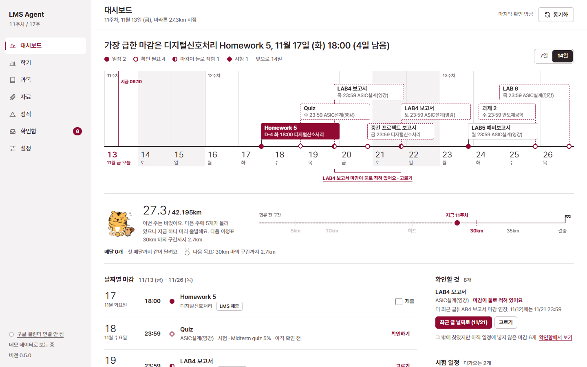
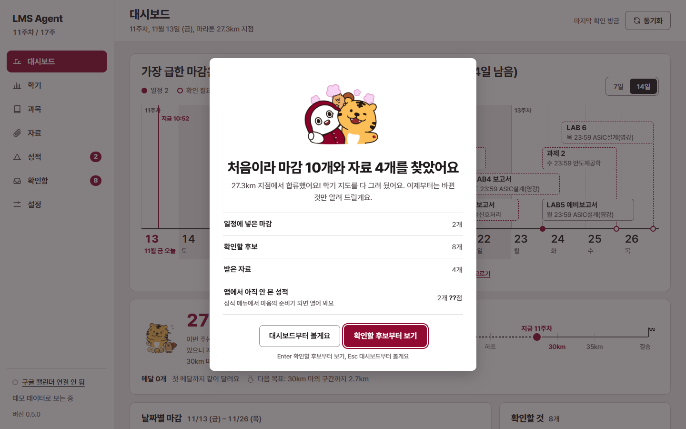
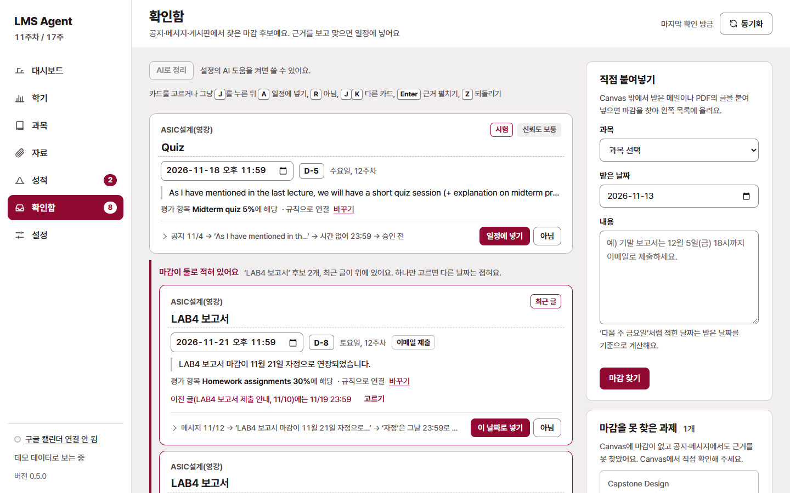
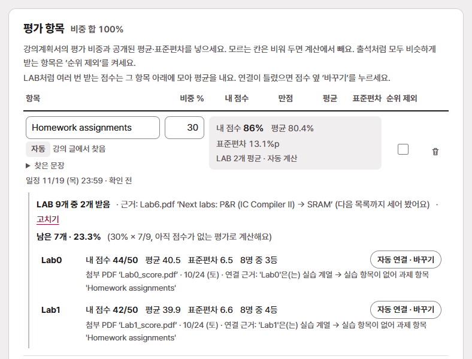
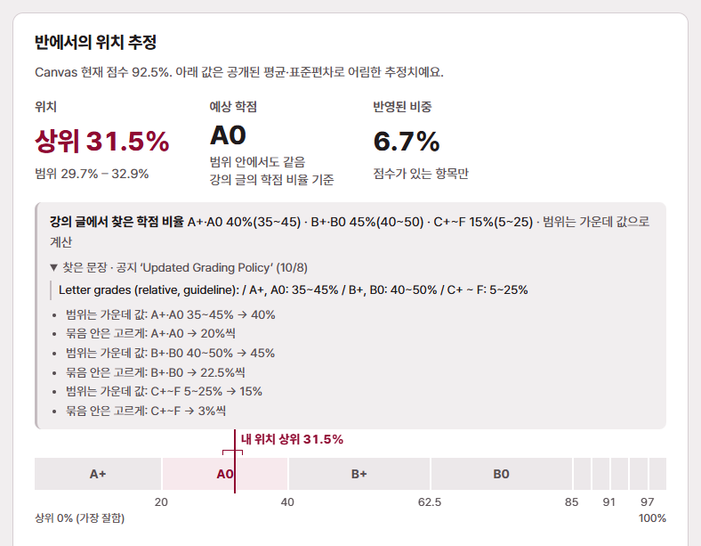
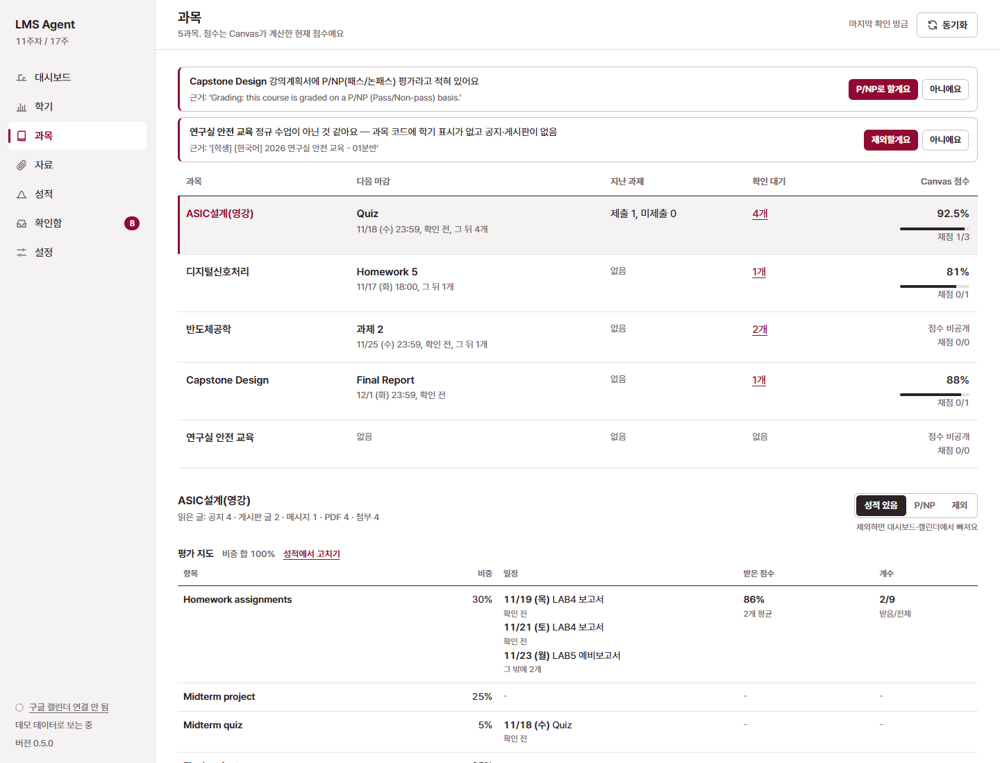

# LMS Agent

**개강부터 종강까지 같이 달리는 학기 페이스메이커.** Canvas에 마감이 안 나오는 과제까지 찾아 구글 캘린더에 넣고, 주차·과목·성적을 한 화면에 모아 줍니다.

Canvas 과제 목록에는 LMS로 내는 과제만 마감이 뜹니다. "조교 메일로 제출", "(due : 23:59 on 11/18)"처럼 마감이 공지·게시판 글·첨부 PDF·메시지에 글로만 적힌 과제는 놓치기 쉽습니다.
LMS Agent는 그 글들을 읽어 마감을 찾고, **근거 문장과 함께** 보여 줍니다. 승인한 마감은 구글 캘린더에 자동으로 반영됩니다.



- **찾기**: 공지, 메시지함, 강의계획서, 과제 설명, **LearningX 게시판 글**, **첨부 PDF**(앱이 직접 읽음)에서 마감을 찾습니다. 같은 과제에 다른 마감이 적혀 있으면(연장 공지 등) 충돌로 알려 줍니다.
- **근거와 결정**: 찾은 마감마다 원문 문장·출처·추정한 부분을 보여 주고 승인을 받습니다. 누가 언제 결정했는지(나 / AI) 남고, 언제든 되돌릴 수 있습니다.
- **캘린더**: 구글 캘린더 "LMS 마감" 캘린더에 자동 반영(앱이 만든 캘린더만 건드림). 휴대폰 캘린더에서 바로 보입니다. 원하면 .ics 파일로도 받을 수 있습니다.
- **다른 일정도 대시보드에**(선택): 설정에서 켜면 구글 캘린더의 다른 일정(수업 외 약속·알바·동아리·공휴일)을 읽어 대시보드 날짜 축과 날짜별 목록에 캘린더 색으로 보여 줍니다(마감은 버건디, 범례에서 캘린더별로 숨기기). 읽기만 하고(다른 캘린더는 건드리지 않음), 일정 내용은 이 PC에만 두고 AI에게 보내지 않습니다. 공부 계획은 일정과 겹치는 날을 피하고, 주간 작전은 일정이 몰린 요일도 함께 봅니다.
- **학기 마라톤**: 16주 학기를 42.195km로 보고 지금 몇 km인지, 다음 이정표(하프·30km 마의 구간·결승)까지 얼마나 남았는지 보여 줍니다. 한 주 마감을 다 내면 "주 완주", 연속 완주, 확인함 비우기 같은 보상과 메달이 쌓입니다.
- **동기화 소식**: 동기화 뒤 새 소식이 있으면 가운데 큰 카드로 알려 줍니다 — "과제가 4개 추가되었습니다", "성적이 공개되었습니다 [지금 확인하기] [앗 쫄려요… 나중에 볼래요]", "자료가 도착했어요", "평가 비중이 바뀌었어요".
- **성적**: 점수 공지·성적 PDF(학번을 넣으면 내 줄만 찾음)에서 평균·표준편차·등수를 읽어 반에서의 위치와 예상 학점을 추정하고, 성적이 나오면 구간에 맞게 반응합니다(A는 축하, C 이하는 위로). 평가 비중은 강의계획서·공지·PDF에서 자동으로 찾고, 학기 중 바뀐 공지("Updated Grading Policy")가 있으면 그걸 따릅니다.
  LAB0·LAB1처럼 여러 번 받는 점수는 강의계획서의 어느 항목(예: Homework assignments 30%)인지 알아서 연결하고, 총 몇 개인지도 근거로 추정해("Next labs: P&R → STA → SRAM" → 7개) 남은 비중까지 계산에 넣습니다.
- **시험 일정**: 찾은 시험·퀴즈를 평가 항목에 연결해 "다가오는 시험"과 "아직 날짜가 공지되지 않은 시험(예: Final quiz 5%)"을 함께 보여 줍니다.
- **과목 종류**: 과목마다 성적 있음 / P/NP(학점 추정 안 함) / 제외(대시보드·캘린더·성적에서 빠짐)를 고릅니다. 정규 수업이 아닌 교육 과정처럼 근거가 있으면 먼저 물어봅니다.
- **자료**: 게시판·공지 첨부 파일, 그리고 과제 설명·강의계획서에 링크된 파일을 `문서\LMS Agent\<과목>\<게시판>\<글>\`에 자동으로 받아 둡니다(바뀐 파일만, 같은 파일은 한 번). 자료 화면은 과목별로 접고 펼치며, 과목 안에서 과제·공지·강의자료·강의계획서·기타 게시판으로 나눠 보고, 분류 칩·검색으로 찾습니다.
- **백그라운드 동기화**(선택): 앱을 열지 않아도 Windows 작업 스케줄러가 정해진 간격으로 확인하고, 새 마감이 생기면 Windows 알림을 띄웁니다.
- **AI 도움**(선택, 기본 꺼짐): 이 PC에 설치된 에이전트 CLI(Claude Code·OpenAI Codex·Gemini CLI·OpenCode·GitHub Copilot CLI·로컬 모델 ollama·직접 지정 중 선택)가 확인함의 미결정 후보를 정리합니다. 근거 문장이 원문에 그대로 있는지 등 하네스가 검증한 결정만 "AI" 표시·이유와 함께 반영되고, 하나씩 되돌릴 수 있습니다. 도구·셸 실행을 끄는 옵션이 확인된 CLI만 "안전"으로 자동 선택되고, 설정에서 [연결 시험]으로 미리 확인할 수 있습니다.
- **에이전트에게 묻기**: 놓친 것 찾기만이 아니라 물어보면 답하고, 시키면 대신 합니다. 한 대화 안에서 이어 물을 수 있고("ASIC 기말 범위는?" → "그럼 중간은?"), [신규 대화]·이전 대화 목록이 있습니다. 학업 밖 이야기(인사·응원·날짜, AI를 켜면 자유 대화)도 받습니다. 답과 제안에는 늘 원문 인용이 붙고, 상태를 바꾸는 것은 [실행]·[반영]을 눌러야 하며 되돌릴 수 있습니다(AI가 꺼져 있어도 규칙으로 동작). 터미널에서는 `python -m lms_agent ask "…"`.
  - **놓친 것**: "기말고사 날짜가 안 보여요", "LAB 점수가 안 들어가요" → 모아 둔 글에서 찾아 마감·점수 연결을 제안.
  - **과목 질문**: "기말 범위 어디까지야?", "지각 제출하면 감점 몇 %?" → 강의계획서·공지 문장을 인용해 답.
  - **성적 '만약에'**: "기말에서 몇 점 받아야 A?", "LAB 하나 0점이면?" → 성적 화면과 같은 계산(숫자는 앱이 계산, 성적은 밖으로 안 보냄).
  - **문의 메일 초안**: "LAB4 연장 문의 메일 써줘" → 공지에서 찾은 조교·교수 주소와 과목·과제·마감을 채운 초안(보내지 않음, 복사·메일 앱으로 열기).
  - **공부 일정**: "기말 전 2주 공부 계획 세워줘" → 마감이 몰린 날을 피한 공부 블록 → [캘린더에 넣기]로 구글 캘린더·.ics에 "[공부]" 일정.
  - **명령**: "주간 요약 꺼줘", "지금 동기화해줘", "로공개 P/NP로 바꿔줘", "컴퓨터 켤 때 자동 실행해줘", "앱 꺼줘" → 화면 단추와 같은 기능을 [실행] 한 번으로. 로그아웃·데이터 지우기·학번·AI 켜기·구글 연결 해제는 직접 하도록 남겨 둡니다.
- **코치 카드**: 월요일마다 이번 주 작전(마감이 몰린 요일, 다가오는 시험 D-day, 어느 과목부터, 페이스), 월·화요일엔 지난주 돌아보기, 종강하면 학기 리포트. 연장 공지처럼 마감이 바뀌면 "바뀐 마감"에 이전 → 새 날짜와 근거 문장을 보여 줍니다. 앱을 안 열어도 주간 작전·보상은 Windows 알림으로 옵니다(성적은 알림에 넣지 않음).
- **과제 체크리스트**: 과제 설명·공지에서 제출 요건(PDF 한 파일, 파일명 규칙, 분량, 포함할 것, 제출처, 개인/팀, 지각 규정)을 뽑아 항목마다 체크리스트로. 직접 추가·체크한 것은 다시 동기화해도 남습니다.
- **컴퓨터를 켜면 앱 열기**(선택): 로그인할 때 앱을 창 없이 켜고 원하면 브라우저도 엽니다(Windows 작업 스케줄러 · macOS LaunchAgent · Linux 자동 시작). 이미 켜져 있으면 브라우저만 열고, 설정에서 [앱 끄기]로 끕니다.

## 화면 둘러보기

아래 화면은 모두 **데모 데이터**(가짜 Canvas·가짜 과목·가짜 학번)입니다. `python -m lms_agent demo`로 똑같이 볼 수 있습니다.

### 1. 처음 켜면: 학기 지도를 한 번에

처음 동기화가 끝나면 무엇을 찾았는지 한 장으로 알려 줍니다. 이후에는 바뀐 것만 소식 카드로 띄웁니다("과제가 N개 추가되었습니다", "성적이 공개되었습니다 [지금 확인하기] [앗 쫄려요… 나중에 볼래요]"). 성적은 바로 보여 주지 않고 마음의 준비가 되면 열어 봅니다.



### 2. 대시보드: 가장 급한 마감, 날짜 축, 학기 마라톤 (맨 위 그림)

맨 위 한 줄이 가장 급한 마감입니다. 날짜 축에서 ● 일정에 넣은 마감, ○ 확인이 필요한 후보, ◐ 날짜가 둘로 적힌 과제, ◆ 시험을 구분합니다. 그 아래 마라톤 띠는 학기를 42.195km로 보고 합류한 뒤 달린 거리와 다음 이정표를 보여 줍니다(합류 전 구간은 회색 — 메달은 합류한 뒤에만). 오른쪽 아래에는 확인할 것과 시험 일정(다가오는 시험 + 날짜 미공지)이 있습니다.

### 3. 확인함: 근거를 보고 한 번에 결정

찾은 마감마다 원문 문장, 어느 평가 항목에 해당하는지(예: "Midterm quiz 5%에 해당 · 규칙으로 연결"), 날짜를 어떻게 읽었는지(공지 11/4 → '…' → 시간 없어 23:59)를 보여 줍니다. 연장 공지처럼 마감이 둘로 적힌 과제는 최근 글이 위에 오고 **하나만** 고를 수 있습니다(캘린더에도 하나만). `J`·`K`로 옮기고 `A`로 넣고 `R`로 뺍니다.



### 4. 성적: LAB 점수가 알아서 항목으로

성적 공지에 붙은 점수표 PDF에서 내 학번 줄만 찾아 평균·표준편차·등수를 읽습니다(다른 학생의 줄은 저장하지 않음). LAB0·LAB1은 "Homework assignments"에 자동으로 모이고, 총 LAB 수는 강의 자료 속 단서로 추정해 근거와 함께 보여 줍니다. 틀리면 [고치기]·[바꾸기]로 바로 고칩니다.



학점 비율도 강의계획서·공지에서 찾아 씁니다. "A+, A0: 35~45%"처럼 범위로 적혀 있으면 가운데 값으로 계산하고, 어느 글의 어떤 문장에서 찾았는지 함께 보여 줍니다. 점수 기준표(절대평가)가 적혀 있으면 순위 대신 예상 총점으로 학점을 매기고, 못 찾으면 기본 비율로 "기본 비율이라면 B+"처럼만 말합니다. 직접 넣은 비율이 언제나 우선입니다.



### 5. 과목: 평가 지도와 과목 종류

과목마다 평가 항목·비중·일정·받은 점수·개수를 한 표로 봅니다(평가 지도). 실제로 듣지 않는 교육 과정은 [제외], 패스/논패스 과목은 [P/NP]로 바꾸면 대시보드·캘린더·성적 추정이 그에 맞게 바뀝니다. 앱은 근거가 있을 때만 먼저 제안합니다.



## 개인정보와 보안

- 화면은 이 PC의 `127.0.0.1`에서만 열립니다. Canvas에는 **읽기만** 하고(메시지도 읽음 처리하지 않음) 아무것도 쓰지 않습니다.
- Canvas 토큰과 구글 토큰은 이 PC에만, Windows에서는 Windows 암호화(DPAPI)로 저장됩니다. 학교 포털 비밀번호는 받지 않습니다.
- 성적·학번은 이 PC에만 있습니다. 학번은 화면에 가려서 보입니다.
- 새 버전 확인은 GitHub에 최신 버전 번호만 묻습니다(내 정보 없음, 설정에서 끌 수 있음). 업데이트 파일은 체크섬이 맞을 때만 씁니다.
- AI 도움을 **켠 경우에만** 강의 글 일부(한 번에 최대 12,000자)가 고른 AI 서비스로 갑니다(ollama 같은 로컬 모델은 이 PC 밖으로 나가지 않음). 보내기 전에 이메일·전화·학번·링크·이름을 가리고, 점수와 성적 파일은 보내지 않습니다. 실행 기록에는 내용 없이 횟수·시간만 남습니다.

## 바로 써 보기 (데모)

Canvas 계정 없이 가짜 데이터로 화면을 볼 수 있습니다(가짜 Canvas·가짜 구글·가짜 AI — 실제 서비스에 접속하지 않음).

**설치 방법은 둘 중 하나**입니다.

- **실행 파일(파이썬 필요 없음, 추천)**: [릴리스](https://github.com/hbean00/LMS_agent/releases)에서 `lms-agent-windows.exe`(맥은 macOS 파일)를 받아 더블클릭. 데모는 명령 창에서 `lms-agent-windows.exe demo`.
- **파이썬(3.9 이상)으로 설치**: 아래처럼 `python -m …` 꼴로 실행하면 PATH 설정과 상관없이 됩니다(Windows는 `python` 대신 `py`도 됨).

```bash
python -m pip install git+https://github.com/hbean00/LMS_agent
```

```bash
python -m lms_agent demo
```

`lms-agent` 명령으로도 실행할 수 있지만, 파이썬의 Scripts 폴더가 PATH에 있을 때만 됩니다(파이썬 설치 때 "Add python.exe to PATH"를 켰으면 됨). "'lms-agent'은(는) 내부 또는 외부 명령… 아닙니다"가 나오면 `python -m lms_agent`를 쓰세요. 아래 명령표의 `lms-agent`도 모두 `python -m lms_agent`로 바꿔 쓸 수 있습니다.

## 내 Canvas에 연결하기

1. 앱을 켭니다(exe면 더블클릭, 파이썬이면 `python -m lms_agent`). 브라우저에 화면이 열립니다.
2. 화면의 **토큰 발급 페이지 열기**를 누르면 Canvas 설정이 열립니다 → **새 액세스 토큰** → 용도에 "LMS Agent" → 발급 → 토큰 복사.
   (토큰은 한 번만 보입니다. 학교가 토큰 발급을 막아 둔 경우 버튼이 없습니다.)
3. 토큰을 붙여 넣으면 Canvas에 실제로 연결되는지 확인하고("OO님으로 연결됨") 바로 첫 동기화를 합니다. 튜토리얼이 화면을 하나씩 짚어 줍니다.

토큰은 Canvas 계정과 같은 권한을 가집니다. 남에게 보여 주지 말고, 그만 쓸 때는 앱에서 로그아웃한 뒤 Canvas 설정에서도 지우세요.
설정 파일 위치: Windows `%APPDATA%\lms-agent\`, macOS `~/Library/Application Support/lms-agent/`, Linux `~/.config/lms-agent/` (`LMS_AGENT_HOME`으로 바꿀 수 있음).

### 구글 캘린더 연결

구글 OAuth 클라이언트(데스크톱 앱)가 필요합니다. `.env.example`을 `.env`로 복사해 `LMS_AGENT_GOOGLE_CLIENT_ID`·`LMS_AGENT_GOOGLE_CLIENT_SECRET`을 넣고 화면의 **구글 캘린더 연결**을 누르세요. 앱은 자기가 만든 "LMS 마감" 캘린더만 만들고 고칩니다(`calendar.app.created` 권한).

### 연결이 안 될 때

- **"보안 인증서를 확인하지 못했어요"**: 앱이 이유와 발급 기관을 함께 알려 줍니다.
  - 발급 기관이 GlobalSign·DigiCert 같은 공개 기관이면 이 PC의 인증서 목록이 비어 있는 경우입니다. v0.6.1부터는 앱에 넣은 공개 루트 목록(Mozilla)으로 해결됩니다. 그 전 버전이면 Microsoft Edge로 학교 LMS 주소를 한 번 열고 다시 연결하세요.
  - 처음 보는 이름(백신·학교·회사 장비)이면 그 프로그램이 HTTPS를 검사하는 경우입니다. 그 프로그램의 HTTPS 검사를 끄거나, 그 루트 인증서 파일(.cer/.crt/.pem)을 `%APPDATA%\lms-agent\certs\`(맥·리눅스는 위 설정 폴더 아래 `certs`)에 넣고 다시 연결하세요. 환경 변수 `LMS_AGENT_CA_FILE`로 파일을 알려 줘도 됩니다.
  - 인증서 검사를 끄는 기능은 없습니다(끄면 토큰이 가로채일 수 있어요).
- **`lms-agent` 명령을 찾을 수 없음**: `python -m lms_agent`로 실행하세요(위 설치 방법 참고).

## 업데이트

새 버전이 나오면 화면 위에 한 줄로 알려 줍니다: "새 버전 v0.6.0이 나왔어요 · 바뀐 점 보기 · **지금 업데이트**".
눌러야만 바뀌고, 바꾸기 전에 기록을 백업합니다.

- **확인**: 앱을 켤 때 하루 한 번 GitHub(`api.github.com`)에 최신 버전 번호만 물어봅니다. 이름·토큰·학교 정보는 보내지 않습니다. 설정 → 업데이트에서 끌 수 있고, [지금 확인]으로 바로 볼 수도 있습니다.
- **실행 파일(exe)**: 새 파일을 받아 릴리스의 `SHA256SUMS.txt`와 맞을 때만 지금 파일과 바꾸고 같은 자리에서 다시 켭니다. 위치가 같아 백그라운드 동기화도 그대로 새 버전을 씁니다.
- **pip로 설치**: 릴리스의 wheel을 같은 방법으로 확인한 뒤 설치하고, [다시 시작]을 누르면 새 버전이 열립니다.
- **소스 폴더(git)**: 고친 파일이 없을 때만 `git pull --ff-only`를 합니다. 고친 파일이 있으면 할 명령만 알려 줍니다.
- **백업**: 바꾸기 직전 데이터 폴더에 `state.before-<새 버전>.json`, `config.before-<새 버전>.json`을 남깁니다. 새 버전은 옛 기록을 그대로 읽어 필요한 만큼만 고칩니다.
- **켤 때 자동 업데이트**(선택, 기본 꺼짐): 설정에서 켜면 앱을 켤 때 새 버전이 있으면 같은 확인·백업을 거쳐 바꾸고 다시 켭니다(exe·pip만).
- 터미널: `lms-agent update`(확인 후 물어봄), `lms-agent update --check`(확인만).

앱 안 업데이트는 v0.6.0부터 들어 있습니다. 그 전 버전(v0.5.0 이하)은 한 번만 직접 바꿔 주세요: [릴리스](https://github.com/hbean00/LMS_agent/releases)에서 새 exe를 받아 지금 파일과 바꾸거나, `pip install -U git+https://github.com/hbean00/LMS_agent`, 또는 소스 폴더에서 `git pull`.

## 명령어

| 명령 | 하는 일 |
|---|---|
| `lms-agent` | 화면 열기 (`serve`와 같음, `--port`, `--no-browser`) |
| `lms-agent demo` | 가짜 데이터로 체험 |
| `lms-agent setup` | 터미널에서 주소·토큰 설정 |
| `lms-agent sync [--push]` | 바뀐 곳만 다시 읽기(`--push`: 끝나면 구글 캘린더 반영) |
| `lms-agent list` | 찾은 마감을 터미널에 출력 |
| `lms-agent update [--check] [-y]` | 새 버전 확인·업데이트(데이터를 먼저 백업) |
| `lms-agent export -o 파일.ics` | 캘린더 파일 저장 |
| `lms-agent google-test` | 구글 캘린더 연결 시험 |
| `lms-agent ai-providers` | 찾은 에이전트 CLI와 상태(안전·확인 필요·없음) |
| `lms-agent ai-eval [--provider ID]` | AI CLI 하네스 평가(데모 문장만 보냄) |
| `lms-agent ask "질문"` | 에이전트에게 묻기(제안 출력, `--apply N`으로 반영) |

## 무엇을 읽나

| 읽는 곳 | 쓰는 곳 |
|---|---|
| 수강 과목, 강의계획서 | 강의계획서 표의 마감·시험, 평가 비중 |
| 과제(마감, 제출 상태, 설명, 점수) | Canvas 마감 일정, 제출 여부, 설명 속 마감, 성적 |
| 공지(최근 120일)와 공지에 링크된 파일 | 공지 속 마감, 성적 PDF, 바뀐 평가 비중 |
| 메시지함(최근 30개 대화) | 조교·교수 메시지 속 마감 |
| LearningX 게시판 글과 첨부(토큰만으로 접근) | 게시판 글 속 마감, 첨부 PDF의 마감·평가 비중 |

**켤 때마다 바뀐 곳만 확인합니다.** 내용이 바뀐 글, 새 메시지가 온 대화, 새로 올라오거나 바뀐 첨부만 다시 읽습니다. 화면의 실행 기록에서 이번에 무엇을 읽고 건너뛰었는지 볼 수 있습니다.

## 한계

- 마감 찾기는 규칙 기반입니다. "11월 20일(목) 23:59", "11/20 자정", "다음 주 금요일까지", "by Nov 30, 11:59 PM", "(due : 23:59 on 11/18)" 같은 표현은 찾지만 특이한 표현은 놓치거나 잘못 읽을 수 있어서, 항상 근거를 보여 주고 승인을 받습니다(AI 도움을 켜면 AI가 정리를 돕습니다).
- 시간이 안 적혀 있으면 23:59로, "자정"은 그날 23:59로 둡니다(화면에 표시됨).
- 암호가 걸린 PDF, 글자 대신 그림으로 된(스캔한) PDF는 읽지 못합니다(화면에 알려 줌).
- 학교 메일(Gmail·Outlook)은 읽지 않습니다. 이메일로 낸 과제의 제출 여부는 직접 체크합니다.
- 성적 위치·예상 학점은 평균·표준편차를 정규분포로 본 **추정**이며, 화면에 근거와 함께 표시됩니다.

## 개발

```bash
pip install -e ".[dev]"
python -m pytest
python scripts/build_exe.py      # pip install pyinstaller 필요
```

표준 라이브러리만 씁니다(실행에 필요한 추가 설치 없음, Python 3.9+). 구조와 모듈 사이 계약은 [docs/CONTRACTS.md](docs/CONTRACTS.md), 진행 기록은 [docs/PROGRESS.md](docs/PROGRESS.md), 개발 안내는 [CLAUDE.md](CLAUDE.md).

## 라이선스

코드는 MIT. **단, `src/lms_agent/web/characters/ku/`의 캐릭터(호이·쿠이, KU BUDDY)는 고려대학교 자산으로 MIT 대상이 아니며**, 고려대 Canvas 사용자에게 비상업적으로만 쓰입니다. 자세한 내용은 그 폴더의 [NOTICE.md](src/lms_agent/web/characters/ku/NOTICE.md)를 보세요. 다른 학교에서는 앱의 오리지널 페이스메이커 캐릭터가 나옵니다.
